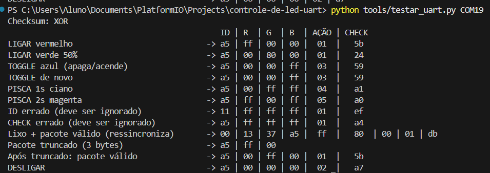
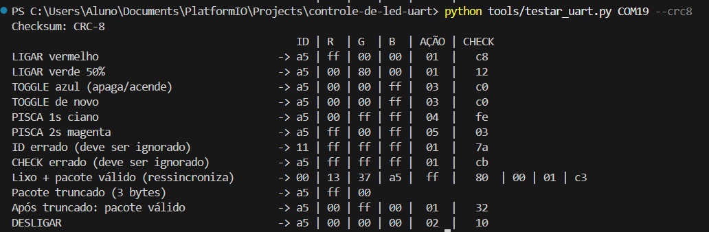

# Controle de LED RGB via UART (FRDM-KL25Z / Zephyr RTOS)

## 1. INTRODUÇÃO

Para essa atividade, o computador envia pacotes de 6 bytes pela UART e a placa FRDM-KL25Z tem de ajustar a cor e o comportamento de um LED RGB.

A linha serial configurada em 8N1 não tem paridade, então a checagem de erros fica por conta do protocolo. Cada pacote leva um ID e um byte de verificação (o receptor ignora qualquer sequência que não passe nas duas conferências) e o firmware roda sobre o Zephyr RTOS.

## 2. OBJETIVO

Cada pacote traz um identificador, os três valores de cor, um código de ação e um byte de verificação. O receptor valida o identificador e esse byte antes de executar qualquer comando.

Também, os pacotes com ID errado ou verificação incorreta não podem travar o sistema, e a leitura deve usar um timeout curto para detectar pacotes truncados. Como bônus, foi feito a troca do XOR por CRC-8 e controlar a intensidade do LED por PWM.

A porta serial de teste trabalha a 115200 bps no formato 8N1 (8 bits de dados, sem paridade, 1 stop bit) e a detecção de erros fica por conta do protocolo, não da linha serial.

> **OBS.:** Os testes no computador usam um script em Python com a biblioteca `pyserial`, que monta os pacotes já com o byte de verificação calculado.

## 3. PROTOCOLO

Cada pacote tem exatamente 6 bytes, na ordem `ID`, `R`, `G`, `B`, `AÇÃO` e `CHECK`. O `ID` identifica o pacote como destinado a este receptor e o `RGB` vai de `0` a `255` e define a cor. Há também uma ação específica para cada código, sendo o seguinte: `0x01` (liga o LED), `0x02` (desliga o LED), `0x03` (alterna o estado), `0x04` (pisca o LED a cada 1s), `0x05` (pisca o LED a cada 2 segundos). E qualquer outro código é tratado como pacote inválido e ignorado.

O `CHECK`, na versão padrão, é o XOR dos cinco primeiros bytes. No pacote `a5 ff 00 00 01 5b`, que liga o vermelho, a conta é: `A5` xor `FF` dá `5A`, os dois bytes zero não mudam o resultado e `5A` xor `01` dá `5B`.

## 4. ARQUITETURA

A UART opera por interrupção: a rotina de interrupção (ISR) lê os bytes do FIFO (*first in first out*) do hardware e coloca cada um em uma fila do kernel, uma `k_msgq` de 128 bytes. A ISR só faz isso, o que a mantém curta e evita perder bytes a 115200 bps.

A thread principal (`main`) consome a fila e monta os pacotes e sem nenhum byte pendente, ela espera sem limite de tempo (`K_FOREVER`). Depois de receber parte de um pacote, espera no máximo 50 ms pelo próximo byte, valor definido em `RX_TIMEOUT_MS`. Se o tempo estoura, o pacote é considerado truncado, os bytes parciais são descartados e a montagem recomeça do zero, atendendo a exigência de timeout curto.

O piscar do LED não interrompe o funcionamento do parser (leitura dos bytes), pois é executado separadamente pelo sistema por meio de uma tarefa programada (`k_work_delayable`). Como o parser e a tarefa de piscar podem acessar o LED ao mesmo tempo, utilizamos um mutex chamado `led_lock` para proteger essas informações. Assim, quando um comando chega enquanto o LED está sendo atualizado, ele espera até que a operação termine, evitando conflitos no funcionamento.

O caminho do sistema é: UART, ISR, fila de bytes, parser com timeout, função `led_execute` e hardware do LED.

## 5. IMPLEMENTAÇÃO

O parser do sistema valida o ID já no primeiro byte e qualquer byte diferente de `0xA5` é descartado na hora, então o lixo que chega antes de um pacote real é ignorado sem esperar seis bytes. Com os seis bytes na mão, o `CHECK` é recalculado sobre os cinco primeiros e comparado com o sexto. Se isso não condizer, o parser procura outro `0xA5` dentro dos bytes já lidos e recomeça a partir dele, assim o receptor volta a sincronizar sozinho depois de um erro, em vez de ficar defasado por um byte.

O checksum tem duas versões, escolhidas em tempo de compilação pela macro `USE_CRC8`. Com valor `0`, vale o XOR pedido no enunciado. Com valor `1`, vale o CRC-8 de polinômio `0x07`, que é o bônus.

Caso o devicetree da placa tiver os aliases `red-pwm-led`, `green-pwm-led` e `blue-pwm-led`, cada cor sai por um canal PWM com período de 1 ms, o que dá controle real de intensidade. Agora, se não tiver os aliases, o código usa GPIO e qualquer valor acima de zero liga o canal e zero o desliga. Ademais, `LIGAR`, `DESLIGAR` e `TOGGLE` cancelam qualquer pisca em andamento, e `TOGGLE` inverte o estado atual aplicando a cor recebida. As ações de pisca começam com o LED aceso.

## 6. TESTES

Os testes usaram o script `tools/testar_uart.py`, que envia os pacotes pela `COM19` e imprime cada caso para comparar com o LED. Todos os casos abaixo se comportaram como esperado, e em nenhum o sistema travou.

Nas ações de `0x01` a `0x05`, utilizando cores diferentes, o LED deve ligar, desligar, alternar ou piscar nos intervalos de 1 e 2 segundos. Agora quando o ID enviado é diferente de `0xA5`, o byte é descartado e o LED permanece inalterado, caso o `CHECK` esteja incorreto, o pacote é ignorado e o receptor aguarda o próximo `0xA5` para sincronizar novamente. E quando há dados inválidos antes de um pacote correto, esses dados são ignorados e o pacote válido é executado normalmente. Por fim, quando um pacote é enviado de forma incompleta/truncado, os bytes são descartados após 50 ms, permitindo que o próximo pacote seja recebido e processado normalmente.

*Controle de led UART usando XOR*

*Controle de led UART usando CRC8*

## 7. VÍDEOS DE DEMONSTRAÇÃO

- [Vídeo de demonstração — Checksum XOR](https://drive.google.com/file/d/1DMaXtSZlFBSN3xc1eU8P2jynweH39MCH/view?usp=sharing)
- [Vídeo de demonstração — Checksum CRC-8](https://drive.google.com/file/d/1bNJcKMgdv-bYZdZdBVRYe1mXDy53yrsE/view?usp=sharing)
