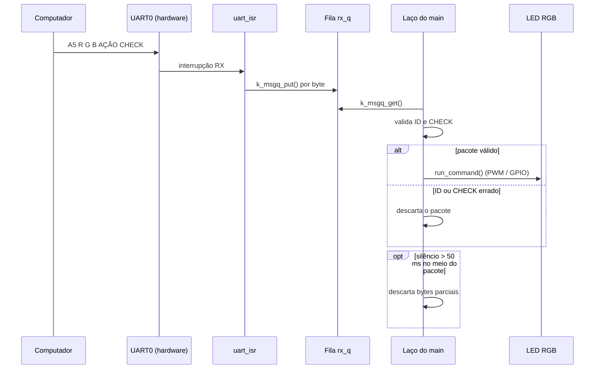

# Controle de LED RGB por UART (FRDM-KL25Z / Zephyr RTOS)

## 1. INTRODUÇÃO

Nesta atividade, um computador envia pelo cabo USB (UART0 da OpenSDA) pacotes de 6 bytes para a placa FRDM-KL25Z, que interpreta cada pacote e altera a cor e o comportamento de um LED RGB. O firmware foi escrito em C sobre o Zephyr RTOS.

A linha serial segue o formato 8N1, portanto **não há paridade na camada física**. A detecção de erros é feita no próprio protocolo: cada pacote carrega um byte de identificação e um byte de verificação, e o receptor só executa o comando quando os dois conferem.

## 2. OBJETIVO

- Receber pacotes `ID | R | G | B | AÇÃO | CHECK` e validar `ID` e `CHECK` antes de qualquer ação.
- Executar `LIGAR`, `DESLIGAR`, `TOGGLE`, `PISCA 1s` e `PISCA 2s`.
- Tratar pacotes inválidos (ID errado, CHECK incorreto, ação desconhecida) e truncados **sem travar** o sistema, usando um timeout curto entre bytes.
- **Bônus:** CRC-8 no lugar do XOR e controle de intensidade do LED por PWM.

## 3. UART E CONFIGURAÇÃO DO TESTE

A UART é um protocolo serial **assíncrono**: não existe clock compartilhado, então transmissor e receptor precisam combinar os parâmetros da linha antes de conversar, e o receptor precisa detectar sozinho o início de cada byte (start bit).

| Parâmetro | Valor |
|---|---|
| Baud rate | 115200 bps |
| Formato | 8N1 (8 bits de dados, sem paridade, 1 stop bit) |
| Linhas | TX e RX (UART0, ponte USB da OpenSDA) |
| Recepção | por interrupção (`CONFIG_UART_INTERRUPT_DRIVEN`) |

Como o console do Zephyr usa a mesma UART, ele foi desligado em `zephyr/prj.conf` (`CONFIG_CONSOLE=n`, `CONFIG_UART_CONSOLE=n`) para que nenhum `printk` se misture aos bytes do protocolo.

## 4. PROTOCOLO

Cada pacote tem exatamente 6 bytes:

| Byte | Campo | Descrição |
|---|---|---|
| 0 | `ID` | Fixo em `0xA5`. Identifica o pacote como destinado a este receptor |
| 1 | `R` | Intensidade do vermelho, `0x00` a `0xFF` |
| 2 | `G` | Intensidade do verde, `0x00` a `0xFF` |
| 3 | `B` | Intensidade do azul, `0x00` a `0xFF` |
| 4 | `AÇÃO` | Código do comando (tabela abaixo) |
| 5 | `CHECK` | Verificação dos 5 primeiros bytes |

| Código | Ação | Efeito |
|---|---|---|
| `0x01` | LIGAR | Acende o LED com a cor recebida |
| `0x02` | DESLIGAR | Apaga o LED (mantém a última cor guardada) |
| `0x03` | TOGGLE | Guarda a cor recebida e inverte aceso/apagado |
| `0x04` | PISCA 1s | Pisca com 1 s aceso e 1 s apagado |
| `0x05` | PISCA 2s | Pisca com 2 s aceso e 2 s apagado |

Qualquer outro código de ação é rejeitado, mesmo com `CHECK` correto.

### 4.1 Verificação (CHECK)

**XOR (padrão do enunciado).** O `CHECK` é o XOR dos cinco primeiros bytes. Para `A5 FF 00 00 01` (LIGAR vermelho):
`A5 ^ FF = 5A`, os dois zeros não alteram o valor e `5A ^ 01 = 5B`, resultando em `A5 FF 00 00 01 5B`.

**CRC-8 (bônus).** Polinômio `0x07`, valor inicial `0x00`, sem reflexão e sem XOR final. O mesmo pacote fica `A5 FF 00 00 01 C8`.

A escolha é feita em tempo de compilação pela macro `USE_CRC8` (em `zephyr/CMakeLists.txt`, `target_compile_definitions(app PRIVATE USE_CRC8=1)`; remova a linha para voltar ao XOR).

> O XOR é fraco: dois bytes trocados ou compensados passam despercebidos. O CRC-8 detecta qualquer rajada de erro de até 8 bits e é bem mais robusto contra combinações de erro, por isso foi implementado como bônus.

## 5. ARQUITETURA

O caminho dos dados é: **UART → ISR → fila de bytes → laço do `main` → validação → LED**.

- **ISR (`uart_isr`)**: só lê os bytes do FIFO da UART e os coloca numa fila do kernel (`k_msgq` de 128 bytes). Não interpreta nada, o que a mantém curta e evita perder bytes a 115200 bps.
- **Laço do `main`**: tira os bytes da fila e monta o pacote. Sem pacote em andamento, espera sem limite (`K_FOREVER`). No meio de um pacote, espera no máximo `BYTE_TIMEOUT_MS` (50 ms); se estourar, descarta os bytes parciais.
- **Pisca**: roda numa tarefa agendada (`k_work_delayable`), então o recebimento continua normal enquanto o LED pisca.
- **Concorrência**: o estado do LED é usado pelo `main` e pela tarefa de pisca, por isso é protegido por um mutex (`led_mutex`).

### 5.1 Diagrama de sequência



O mesmo diagrama em D2 (para o [play.d2lang.com](https://play.d2lang.com/)) está em [`docs/diagrama-sequencia.d2`](docs/diagrama-sequencia.d2).

## 6. IMPLEMENTAÇÃO

### 6.1 Montagem e validação do pacote

O `main` guarda os bytes em `pkt[6]` e conta quantos já chegaram (`n`):

1. Com `n == 0`, qualquer byte diferente de `0xA5` é descartado na hora, então o lixo que chega antes do pacote não atrapalha.
2. Com 1 a 5 bytes, continua acumulando, sujeito ao timeout de 50 ms entre bytes.
3. Com 6 bytes, recalcula o `CHECK` sobre os 5 primeiros e compara com o sexto. Se conferir, chama `run_command()`; se não, o pacote inteiro é descartado e a recepção recomeça.

### 6.2 Comandos

`run_command()` guarda a cor recebida (exceto em `DESLIGAR`, que mantém a última) e aplica a ação com um `switch`. `LIGAR`, `DESLIGAR` e `TOGGLE` cancelam qualquer pisca em andamento, e as ações de pisca começam com o LED aceso. Um código de ação desconhecido é ignorado, mesmo com `CHECK` correto.

### 6.3 Saída do LED: PWM ou GPIO

- Se o devicetree da placa tiver os aliases `red-pwm-led`, `green-pwm-led` e `blue-pwm-led`, cada cor sai por um canal PWM com período de 1 ms, e o valor `0..255` vira o *duty cycle* (controle real de intensidade).
- Sem esses aliases, usa os GPIOs `red_led`, `green_led` e `blue_led` da FRDM-KL25Z: qualquer valor acima de zero liga o canal e zero o desliga.

### 6.4 Pacotes inválidos

| Situação | Tratamento |
|---|---|
| Primeiro byte diferente de `0xA5` | Descartado na hora |
| `CHECK` incorreto | Pacote descartado, LED inalterado |
| `CHECK` correto, ação desconhecida | Ignorado, LED inalterado |
| Pacote parado no meio por mais de 50 ms | Bytes parciais descartados |
| Fila de 128 bytes cheia | Byte novo perdido, sem travar |

## 7. COMO COMPILAR E TESTAR

1. Compilar e gravar com PlatformIO (ambiente `frdm_kl25z` em `platformio.ini`).
2. Instalar a dependência do script: `pip install pyserial`.
3. Rodar o script com a porta serial da placa:

```bash
python tools/testar_uart.py COM5               # firmware com XOR
python tools/testar_uart.py /dev/ttyACM0 --crc8  # firmware com USE_CRC8=1
```

O script monta cada pacote com o `CHECK` já calculado, imprime os bytes enviados e espera o tempo necessário para observar o LED.

## 8. TESTES (TDD)

O ciclo do TDD adotado é: definir o caso de teste, vê-lo falhar, implementar o mínimo para passar e refatorar mantendo tudo verde. Os casos abaixo são os que o script `tools/testar_uart.py` executa, relacionados aos casos típicos de UART:

| Caso típico | Teste no script | Resultado esperado |
|---|---|---|
| Entrada válida | `LIGAR vermelho`, `LIGAR verde 50%` | LED acende na cor enviada |
| Entrada válida (estado) | `TOGGLE azul` duas vezes | Apaga e depois acende |
| Entrada válida (pisca) | `PISCA 1s ciano`, `PISCA 2s magenta` | Alterna nos intervalos de 1 s e 2 s |
| ID inválido | `ID errado` (`0x11`) | Ignorado, LED inalterado |
| CHECK inválido | `CHECK errado` | Ignorado, LED inalterado |
| Lixo na linha | `Lixo + pacote válido` | Lixo ignorado, pacote executado |
| Transmissão interrompida | `Pacote truncado (3 bytes)` e `Após truncado` | Bytes descartados após 50 ms; próximo pacote funciona |
| Encerramento | `DESLIGAR` | LED apaga |
| Entrada vazia | Nenhum byte enviado | Laço dorme em `K_FOREVER`, sem consumo nem ação |
| Buffer grande | Rajada maior que 128 bytes | Bytes em excesso podem ser perdidos, mas o sistema não trava; pacote seguinte é executado |
| RX desabilitado | Não se aplica | A recepção é habilitada uma vez em `main()` e permanece ativa |

> **Observação:** as linhas "Entrada vazia" e "Buffer grande" não fazem parte do script atual (que não foi alterado); descrevem o comportamento esperado do firmware e podem ser reproduzidos enviando os dados manualmente por um terminal serial.
